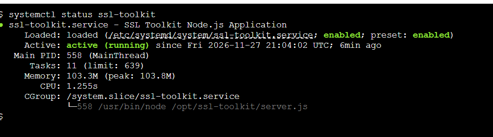
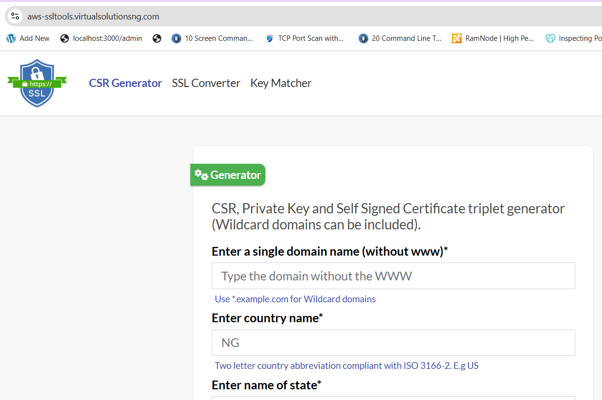
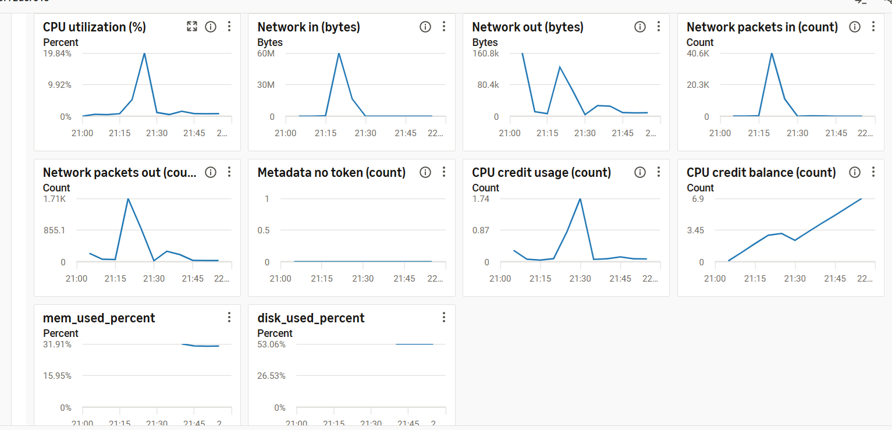
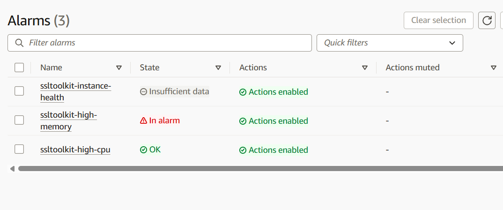
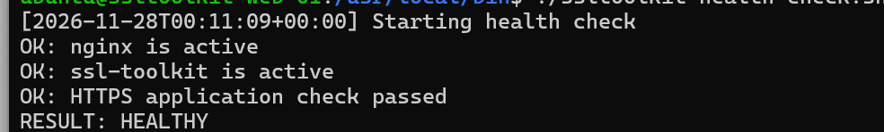

# Evidence screenshots

VPC resource map and subnet route association

Instance characteristics and encrypted EBS root volume

Systemd application status

Browser TLS validity and application response

Actual RAM and disk metrics

Configured alarms, with identifiers redacted

Bash script output

- `incident-recovery.png` — controlled failure / successful recovery output
