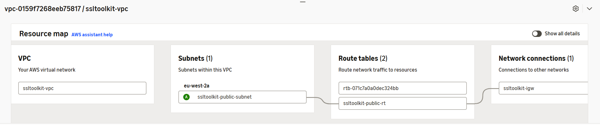
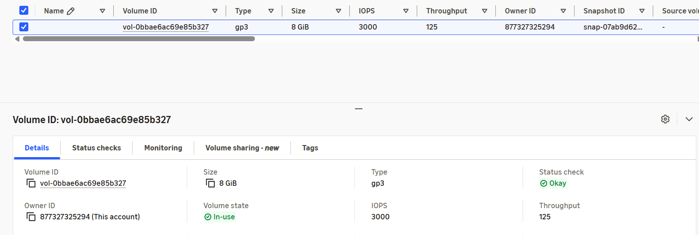

# Evidence screenshots

Add your **own captured and redacted** screenshots here only after validating the result. Suggested filenames:

VPC resource map and subnet route association
 

Instance characteristics and encrypted EBS root volume

- `linux-service.png` — systemd application status (no secrets)
- `https-result.png` — browser TLS validity and application response
- `cloudwatch-metrics.png` — actual RAM and disk metrics
- `cloudwatch-alarms.png` — configured alarms, with identifiers redacted
- `health-check-pass.png` — Bash script output
- `incident-recovery.png` — controlled failure / successful recovery output

